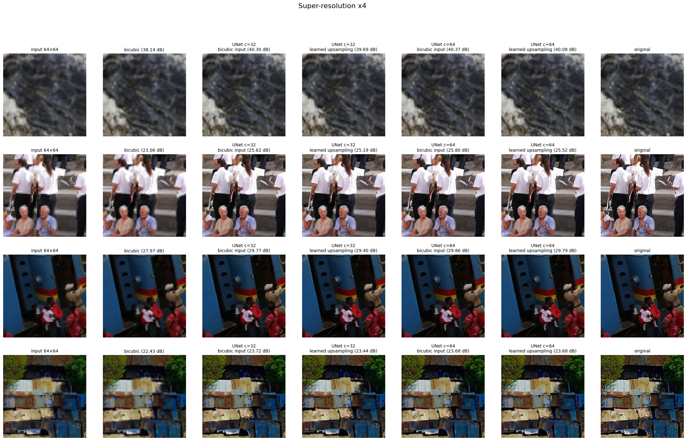
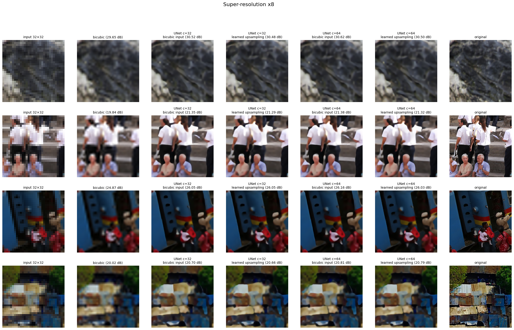
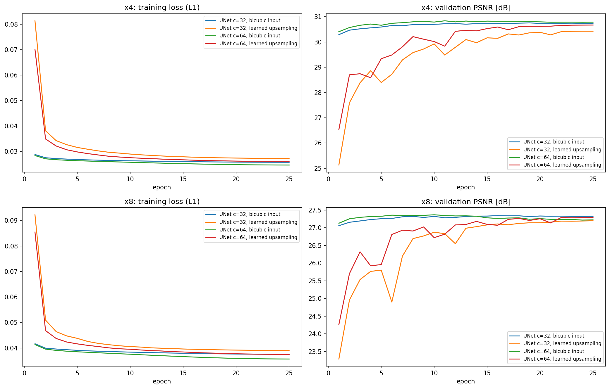
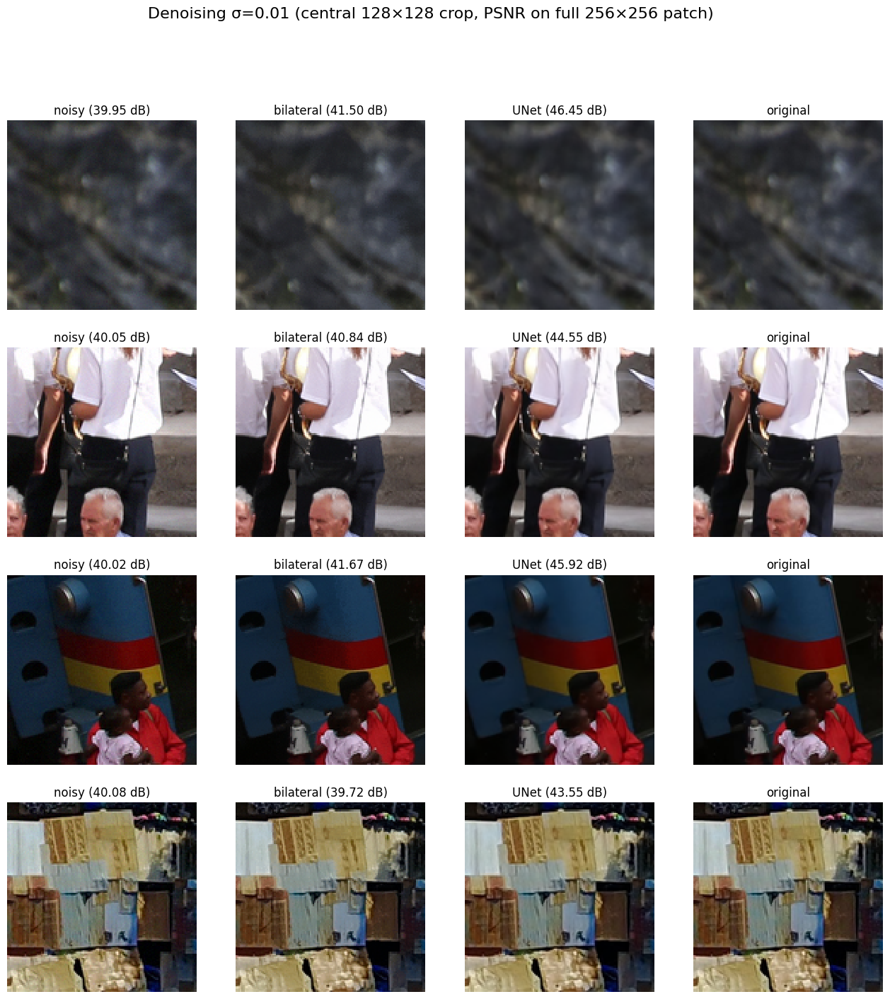
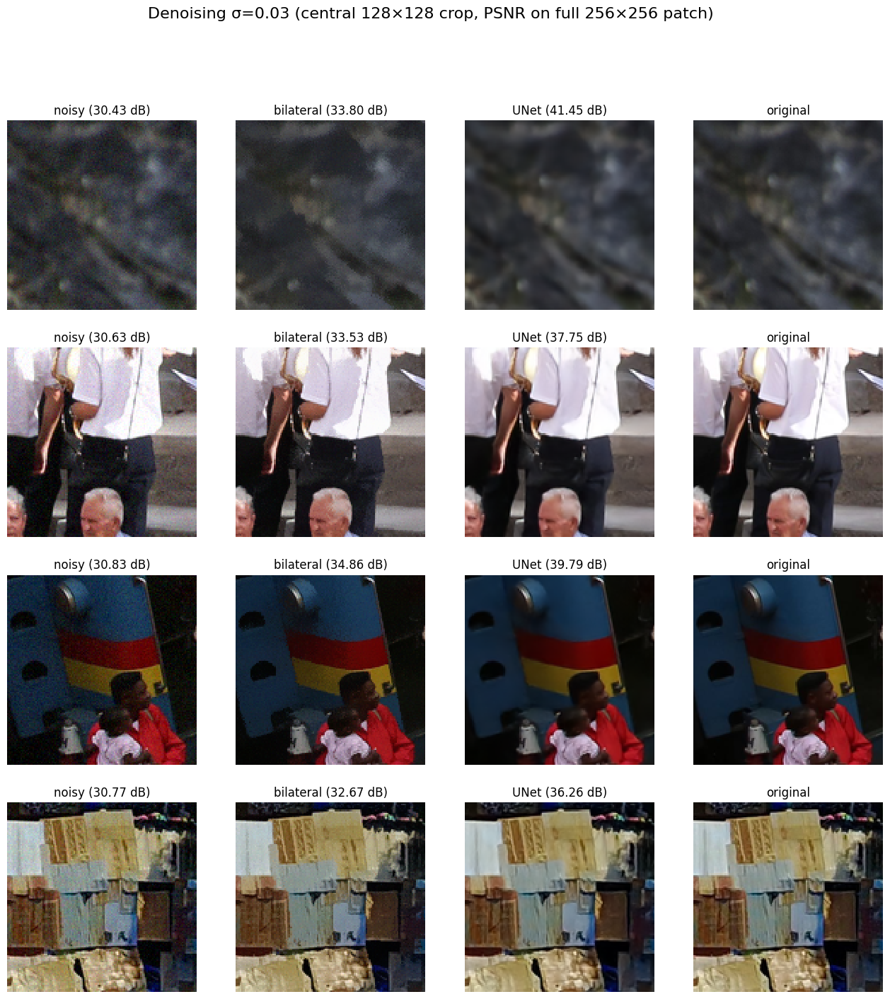
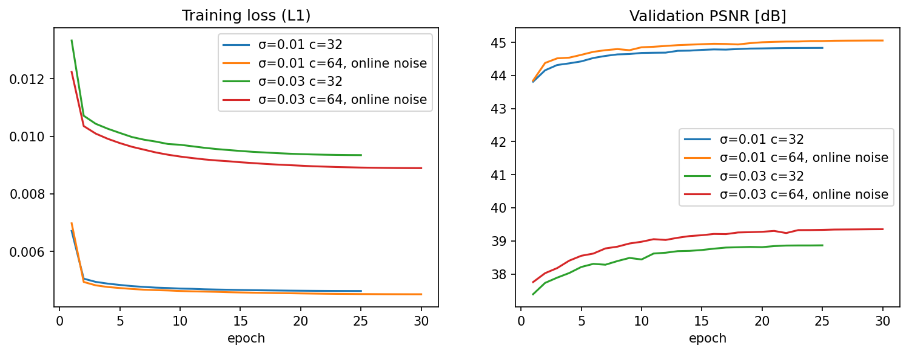

# Projekt 1: Modyfikacja obrazów (SIGK)

**Autorzy:** Natalia Choszczyk, Mikołaj Rowicki

Celem projektu było zaproponowanie jednej architektury sieci neuronowej i użycie jej do dwóch zadań przywracania jakości obrazów. Wybraliśmy **zwiększanie rozdzielczości** (ze współczynnikami ×4 i ×8) oraz **odszumianie** (szum gaussowski o σ = 0.01 i 0.03). W obu zadaniach porównujemy sieć z metodą bazową wskazaną w instrukcji, na całym zbiorze testowym, przy użyciu metryk SNE, PSNR, SSIM i LPIPS.

## 1. Dane i sposób oceny

Korzystamy ze zbioru DIV2K, czyli 900 zdjęć w wysokiej rozdzielczości. Oficjalny zbiór testowy DIV2K nie jest publicznie dostępny, dlatego jako zbiór testowy przyjęliśmy oficjalny zbiór walidacyjny (100 zdjęć). Z 800 zdjęć treningowych wydzieliliśmy 50 jako własny zbiór walidacyjny. Służy on wyłącznie do wyboru najlepszego momentu treningu, dzięki czemu wyniki na zbiorze testowym nie są zawyżone.

Zgodnie z instrukcją pracujemy na obrazach 256×256, dlatego zdjęcia pocięliśmy na kwadratowe fragmenty (patche). Ze zdjęć treningowych wycięliśmy losowo 30 000 patchy. Zdjęcia walidacyjne i testowe pocięliśmy regularną siatką, tak żeby ocena obejmowała całe obrazy. Zbiór testowy liczy 3 598 patchy, a wszystkie wyniki w tabelach to średnie z tych patchy.

Jakość oceniamy czterema metrykami:

| Metryka | Znaczenie | Lepiej |
|---|---|---|
| **PSNR** [dB] | błąd na poziomie pikseli w skali logarytmicznej | wyżej |
| **SSIM** | zgodność struktury obrazu: krawędzi, kontrastu, jasności | wyżej |
| **LPIPS** | podobieństwo percepcyjne, oceniane przez sieć neuronową; dobrze oddaje odczucia człowieka | niżej |
| **SNE** | suma kwadratów różnic pikseli w patchu | niżej |

## 2. Wspólna architektura

W obu zadaniach używamy sieci **U-Net**. Najpierw stopniowo zmniejsza ona obraz, żeby uchwycić jego ogólną treść, a potem powiększa go z powrotem do pełnej rozdzielczości. Połączenia między odpowiadającymi sobie poziomami (połączenia skip) przekazują szczegóły, które inaczej zginęłyby przy zmniejszaniu.

Kluczowe jest uczenie rezydualne: sieć nie tworzy obrazu od zera, tylko przewiduje poprawkę dodawaną do obrazu wejściowego o docelowym rozmiarze 256×256. Na początku treningu ta poprawka wynosi zero, więc wynik sieci jest początkowo równy temu obrazowi i jest stopniowo ulepszany. Przy odszumianiu tym obrazem jest po prostu wejście zaszumione. Przy zwiększaniu rozdzielczości mały obraz trzeba najpierw powiększyć do 256×256. Robimy to na dwa sposoby, opisane w punkcie 3: interpolacją bikubiczną, od której sieć startuje, albo warstwą uczoną, która na początku treningu daje jeszcze obraz bardzo niskiej jakości.

Wszystkie modele trenowaliśmy przez 25–30 epok, minimalizując średnią bezwzględną różnicę pikseli (L1). Ta funkcja straty daje ostrzejsze obrazy niż błąd kwadratowy. Po każdej epoce sprawdzaliśmy wynik na zbiorze walidacyjnym i zachowywaliśmy najlepszy model. Podstawowa wersja sieci (szerokość c = 32) ma ok. 1,9 mln parametrów, a szersza (c = 64) ok. 7,7 mln.

## 3. Zwiększanie rozdzielczości

Obrazy wejściowe 64×64 (×4) i 32×32 (×8) powstały przez pomniejszenie patchy 256×256 funkcją `cv2.resize` z interpolacją **`INTER_AREA`**. Uśrednia ona piksele i nie wprowadza zniekształceń przy zmniejszaniu. Metodą bazową jest powiększenie tą samą funkcją z **interpolacją bikubiczną**.

Sprawdziliśmy dwa sposoby powiększania wejścia sieci. W pierwszym obraz jest najpierw powiększany bikubicznie, a sieć uczy się tylko poprawiać ten wynik. W drugim interpolację zastępuje warstwa, która sama uczy się powiększać obraz. Każdy wariant wytrenowaliśmy w dwóch szerokościach, przy identycznych danych i liczbie epok, tak żeby między porównywanymi modelami zmieniał się tylko jeden czynnik.

| Metoda | PSNR | SSIM | LPIPS | SNE |
|---|---:|---:|---:|---:|
| interpolacja bikubiczna ×4 | 29.58 | 0.7709 | 0.3829 | 642.48 |
| UNet c=32, wejście bikubiczne ×4 | 31.00 | 0.8168 | 0.2633 | 480.46 |
| UNet c=32, powiększanie uczone ×4 | 30.51 | 0.8083 | 0.2705 | 515.54 |
| **UNet c=64, wejście bikubiczne ×4** | **31.08** | **0.8189** | **0.2591** | **474.87** |
| UNet c=64, powiększanie uczone ×4 | 30.83 | 0.8157 | 0.2614 | 490.81 |

Tabela 1: Zwiększanie rozdzielczości ×4 (64×64 → 256×256).

| Metoda | PSNR | SSIM | LPIPS | SNE |
|---|---:|---:|---:|---:|
| interpolacja bikubiczna ×8 | 26.62 | 0.6273 | 0.5574 | 1158.92 |
| UNet c=32, wejście bikubiczne ×8 | 27.61 | 0.6746 | 0.4248 | 965.95 |
| UNet c=32, powiększanie uczone ×8 | 27.32 | 0.6679 | 0.4275 | 987.12 |
| **UNet c=64, wejście bikubiczne ×8** | **27.65** | **0.6766** | 0.4234 | **962.52** |
| UNet c=64, powiększanie uczone ×8 | 27.47 | 0.6742 | **0.4126** | 972.92 |

Tabela 2: Zwiększanie rozdzielczości ×8 (32×32 → 256×256).

Rysunki pokazują cztery przykładowe patche testowe (co 900. patch zbioru), a w podpisach podano PSNR danego obrazu.

**Wnioski.** Wszystkie warianty sieci są lepsze od interpolacji bikubicznej we wszystkich metrykach i dla obu skal. Najlepszy model poprawia PSNR o 1.5 dB dla ×4 i o 1 dB dla ×8 oraz obniża LPIPS o około jedną czwartą do jednej trzeciej. Na obrazach widać to jako wyraźnie ostrzejsze krawędzie, twarze i napisy. Powiększanie ×8 jest znacznie trudniejsze: obraz 32×32 zawiera tak mało informacji, że drobnych detali, np. tekstur, nie da się wiernie odtworzyć.

Interpolacja bikubiczna na wejściu okazała się lepsza od powiększania uczonego, o 0.2–0.5 dB przy tym samym czasie treningu. Wyjaśniają to krzywe uczenia. Sieć z wejściem bikubicznym od pierwszej epoki ma dobry punkt startowy i uczy się jedynie poprawki, więc trening jest szybki i stabilny. Wariant uczony musi najpierw nauczyć się samego powiększania, startuje ze znacznie gorszego poziomu, a jego wynik walidacyjny waha się z epoki na epokę i po 25 epokach wciąż nieznacznie rośnie. Dłuższy trening mógłby więc zmniejszyć tę różnicę. Jedynym wyjątkiem jest metryka LPIPS dla ×8, w której najlepiej wypadł szeroki wariant z powiększaniem uczonym.

Czterokrotne zwiększenie liczby parametrów (c = 64) daje przy wejściu bikubicznym tylko symboliczną poprawę, poniżej 0.1 dB. Większy zysk widać przy powiększaniu uczonym, które ma więcej do nauczenia. Dla ×8 szeroka sieć zaczyna się przeuczać: strata treningowa dalej spada, a wynik walidacyjny po około 10 epokach lekko maleje. Wybór najlepszej epoki na zbiorze walidacyjnym chroni przed tym wyniki testowe.

## 4. Odszumianie
 
Obrazy zaszumiono funkcją `random_noise` z biblioteki scikit-image, dodając szum gaussowski o odchyleniu standardowym σ = 0.01 i 0.03 (dla obrazów o wartościach w zakresie [0, 1]). Zaszumione obrazy zapisano jako 8-bitowe pliki PNG ze stałym ziarnem losowania, dzięki czemu zbiór testowy jest zawsze identyczny.
 
Metodą bazową jest filtr bilateralny `denoise_bilateral`, który wygładza obraz, a jednocześnie stara się zachować krawędzie. Z parametrami domyślnymi filtr rozmywał cały obraz (PSNR ok. 19.7 dB, czyli wyraźnie gorzej niż samo zaszumione wejście), więc jego dwa główne parametry, czyli siłę wygładzania kolorów i zasięg przestrzenny, dobraliśmy przeszukiwaniem siatki na zbiorze walidacyjnym. Dla obu poziomów szumu najlepsze okazało się `sigma_color = 0.5σ` i `sigma_spatial = 3`. Dzięki temu porównujemy sieć z metodą bazową w jej najlepszej konfiguracji.
 
Sieć ma tę samą architekturę co przy zwiększaniu rozdzielczości, tylko bez etapu powiększania: dostaje obraz zaszumiony i przewiduje poprawkę, która usuwa szum. Dla każdego poziomu szumu trenowaliśmy osobny model, w dwóch wariantach. Pierwszy (c = 32, 25 epok) uczył się na obrazach zaszumionych raz, przed treningiem. Drugi jest szerszy (c = 64, 30 epok) i przy każdym użyciu patcha widzi nowy, losowo wygenerowany szum, a obrazy są dodatkowo losowo obracane i odbijane. Dzięki temu w trakcie treningu sieć ogląda znacznie więcej różnych przykładów. W tabelach podano też metryki samego zaszumionego obrazu jako punkt odniesienia.
 
| Metoda | PSNR | SSIM | LPIPS | SNE |
|---|---:|---:|---:|---:|
| obraz zaszumiony σ=0.01 | 40.04 | 0.9552 | 0.0205 | 19.52 |
| denoise_bilateral σ=0.01 | 41.90 | 0.9790 | 0.0144 | 14.03 |
| UNet c=32 σ=0.01 | 44.98 | 0.9890 | 0.0068 | 7.00 |
| **UNet c=64, szum losowany na bieżąco σ=0.01** | **45.24** | **0.9895** | **0.0065** | **6.71** |
 
Tabela 3: Odszumianie, σ = 0.01.
 
| Metoda | PSNR | SSIM | LPIPS | SNE |
|---|---:|---:|---:|---:|
| obraz zaszumiony σ=0.03 | 30.63 | 0.7492 | 0.1457 | 170.58 |
| denoise_bilateral σ=0.03 | 34.81 | 0.9056 | 0.0698 | 71.80 |
| UNet c=32 σ=0.03 | 38.90 | 0.9634 | 0.0356 | 31.71 |
| **UNet c=64, szum losowany na bieżąco σ=0.03** | **39.43** | **0.9658** | **0.0346** | **29.08** |
 
Tabela 4: Odszumianie, σ = 0.03.
 

 

 
Rysunki pokazują środkowe fragmenty 128×128 patchy testowych, a PSNR w podpisach liczono na całym patchu.
 

 
**Wnioski.** Sieć zdecydowanie przewyższa filtr bilateralny we wszystkich metrykach: PSNR rośnie o 3.3 dB przy słabym szumie i o 4.6 dB przy mocniejszym, a LPIPS spada mniej więcej o połowę. Filtr bilateralny szczególnie słabo radzi sobie ze słabym szumem. Przy σ = 0.01 poprawia PSNR tylko o 1.9 dB, a dla 14.5% patchy wręcz go pogarsza, bo nie odróżnia szumu od drobnej tekstury i wygładza jedno i drugie. Sieć, korzystając z szerszego kontekstu obrazu, usuwa szum i jednocześnie zachowuje tekstury, co dobrze widać na porównaniach.
 
Szerszy model z szumem losowanym na bieżąco dał dodatkowe 0.26 dB przy σ = 0.01 i 0.53 dB przy σ = 0.03. W tym eksperymencie zmieniono jednak jednocześnie szerokość sieci, sposób generowania danych i liczbę epok, więc nie da się rozstrzygnąć, która zmiana miała największy wpływ. Krzywe uczenia obu wariantów stabilizują się po około 20 epokach, więc dłuższy trening nie przyniósłby już wyraźnej poprawy.
 
## 5. Podsumowanie
 
Jedna architektura, U-Net z uczeniem poprawki do wejścia, sprawdziła się w obu zadaniach i pokonała obie metody bazowe we wszystkich metrykach. Najważniejszym elementem okazało się właśnie uczenie poprawki do prostego oszacowania, czyli obrazu zaszumionego albo powiększonego bikubicznie. Dzięki temu trening jest szybki i stabilny, a porównanie z powiększaniem uczonym potwierdziło, że interpolacja bikubiczna na wejściu jest dobrym wyborem.
 
Zwiększanie szerokości sieci przyniosło niewielkie korzyści, wyraźniejsze przy odszumianiu niż przy zwiększaniu rozdzielczości. Widać też, że zysk z sieci zależy od trudności zadania. Przy odszumianiu przewaga nad metodą bazową wynosi 3–4.6 dB, bo informacja o obrazie jest wciąż obecna, tylko zakłócona. Przy zwiększaniu rozdzielczości to 1–1.5 dB, bo część szczegółów została bezpowrotnie utracona przy zmniejszaniu.