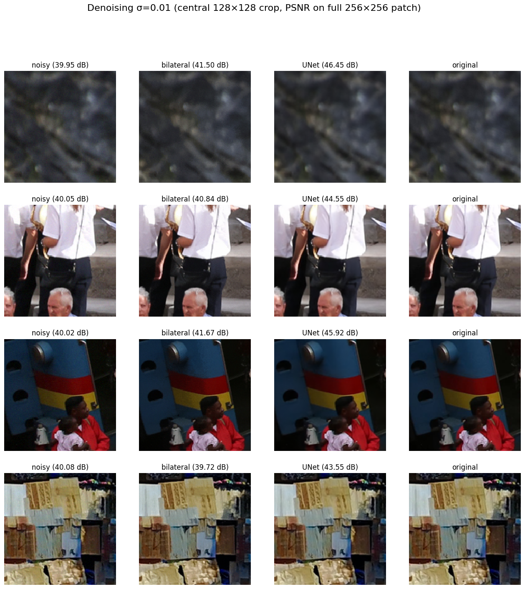
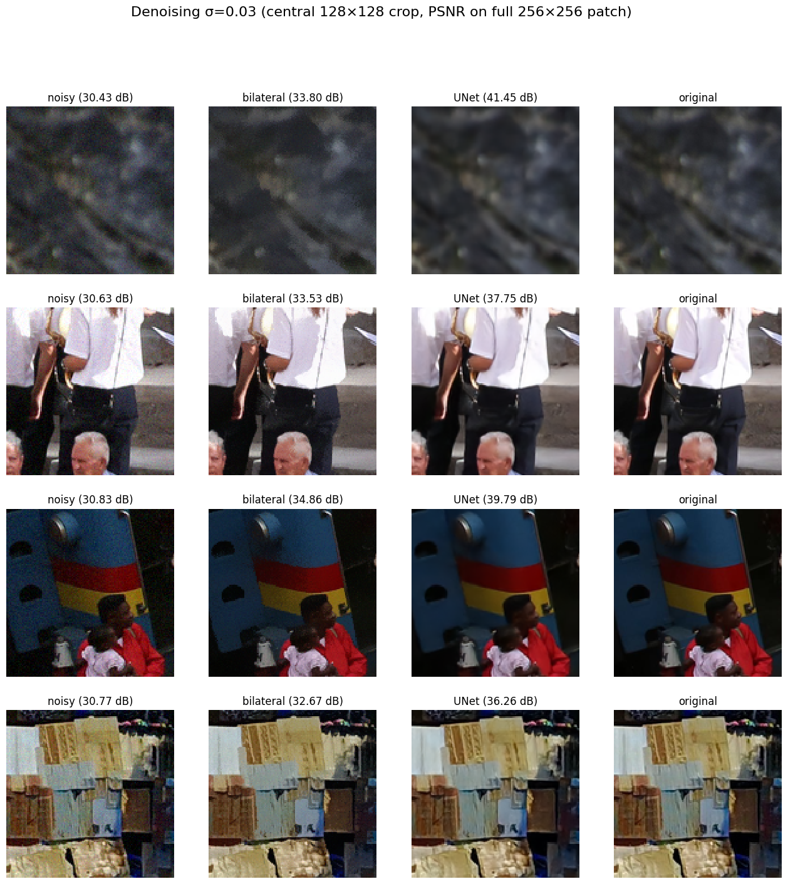
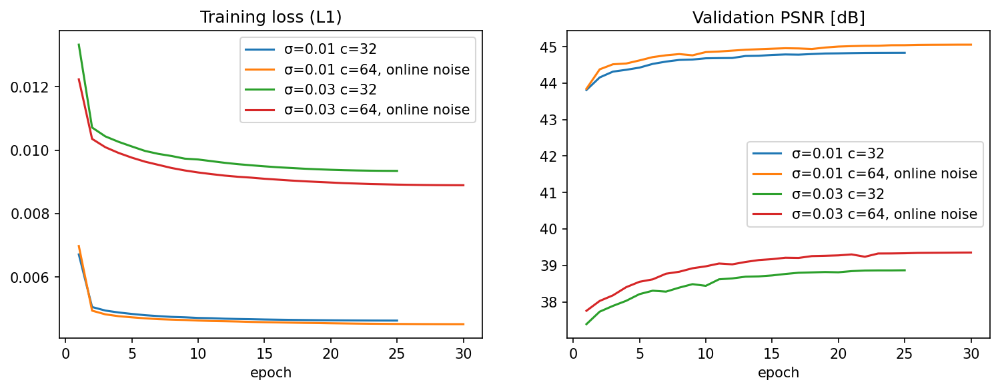

# Odszumianie (zadanie 2.2)

## Dane

- DIV2K pocięte na patche 256×256: trening 0001–0750 (30 000 losowych patchy), walidacja 0751–0800 (1 757), test 0801–0900 (3 598, regularna siatka pokrywająca całe obrazy).
- Szum: `skimage.util.random_noise(mode="gaussian", var=σ²)` dla σ = 0.01 i 0.03 (σ to odchylenie standardowe, obrazy w [0, 1]), zapis do 8-bitowego PNG, stałe ziarno.

## Metody

**Bazowa: `denoise_bilateral`.** Dla parametrów domyślnych filtr rozmywa cały obraz (PSNR ≈ 19.7 dB, gorzej niż wejście), dlatego `sigma_color` i `sigma_spatial` dobrano siatką na zbiorze walidacyjnym. Dla obu σ wygrało `sigma_color = 0.5σ`, `sigma_spatial = 3` (`denoise_results/bilateral_grid.csv`).

**Proponowana: UNet z połączeniem rezydualnym** (`model.py`, ta sama architektura co w SR). Encoder–decoder z trzema poziomami i połączeniami skip; sieć przewiduje poprawkę dodawaną do wejścia, a warstwa wyjściowa jest inicjalizowana zerami, więc trening startuje od jakości zaszumionego obrazu. Osobny model dla każdego σ, strata L1, Adam (lr 2·10⁻⁴, cosine), batch 16, fp16.

| Wariant | Szerokość | Dane treningowe | Epoki |
|---|---|---|---|
| `unet_c32` | c = 32 (1.9 M parametrów) | stały szum zapisany w PNG | 25 |
| `unet_c64_online_noise` | c = 64 (7.7 M parametrów) | szum losowany przy każdym użyciu patcha + losowe obroty i odbicia | 30 |

## Wyniki

Średnie z 3 598 patchy testowych. `noisy` to wejście bez odszumiania.

| Metoda | PSNR | SSIM | LPIPS | SNE |
|---|---|---|---|---|
| noisy_gaussian_noise_0.01 | 40.04 | 0.9552 | 0.0205 | 19.52 |
| denoise_bilateral_gaussian_noise_0.01 | 41.90 | 0.9790 | 0.0144 | 14.03 |
| unet_c32_gaussian_noise_0.01 | 44.98 | 0.9890 | 0.0068 | 7.00 |
| **unet_c64_online_noise_gaussian_noise_0.01** | **45.24** | **0.9895** | **0.0065** | **6.71** |

Tabela 1: Odszumianie, σ = 0.01.

| Metoda | PSNR | SSIM | LPIPS | SNE |
|---|---|---|---|---|
| noisy_gaussian_noise_0.03 | 30.63 | 0.7492 | 0.1457 | 170.58 |
| denoise_bilateral_gaussian_noise_0.03 | 34.81 | 0.9056 | 0.0698 | 71.80 |
| unet_c32_gaussian_noise_0.03 | 38.90 | 0.9634 | 0.0356 | 31.71 |
| **unet_c64_online_noise_gaussian_noise_0.03** | **39.43** | **0.9658** | **0.0346** | **29.08** |

Tabela 2: Odszumianie, σ = 0.03.

Centralne wycinki 128×128; PSNR w podpisach liczone na całym patchu.

## Wnioski

- UNet jest lepszy od `denoise_bilateral` we wszystkich metrykach: +3.3 dB PSNR dla σ = 0.01 i +4.6 dB dla σ = 0.03, przy około dwukrotnie niższym LPIPS.
- Bilateral słabo radzi sobie ze słabym szumem: przy σ = 0.01 zyskuje tylko 1.9 dB, a dla 14.5% patchy pogarsza wynik, bo nie odróżnia szumu od drobnej tekstury. Sieć, korzystając z kontekstu, usuwa szum i zachowuje tekstury.
- Szersza sieć z szumem losowanym na bieżąco dała dodatkowe +0.26 dB (σ = 0.01) i +0.53 dB (σ = 0.03). Obie zmiany wprowadzono jednocześnie, więc ich wpływu nie rozdzielono.
- Krzywe uczenia są płaskie po około 20 epokach, więc dłuższy trening nie poprawiłby wyników.
