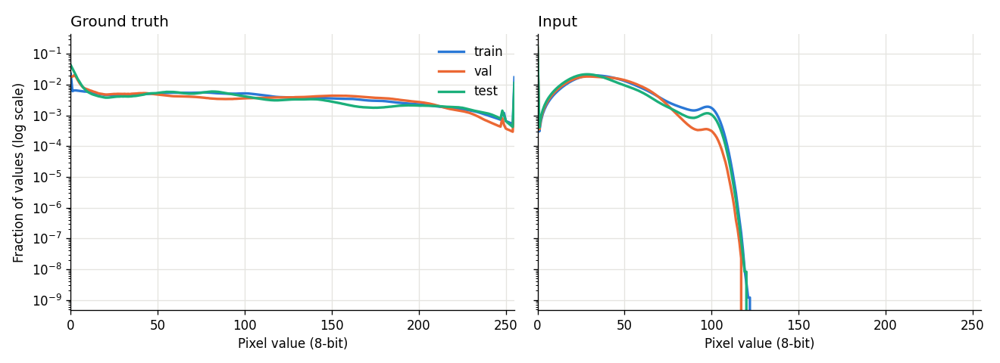
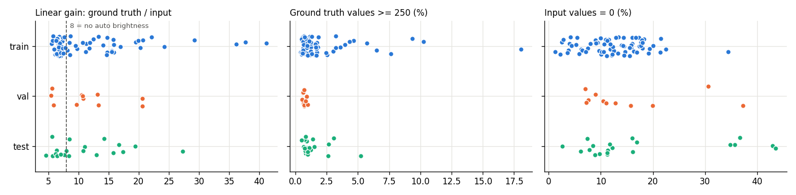
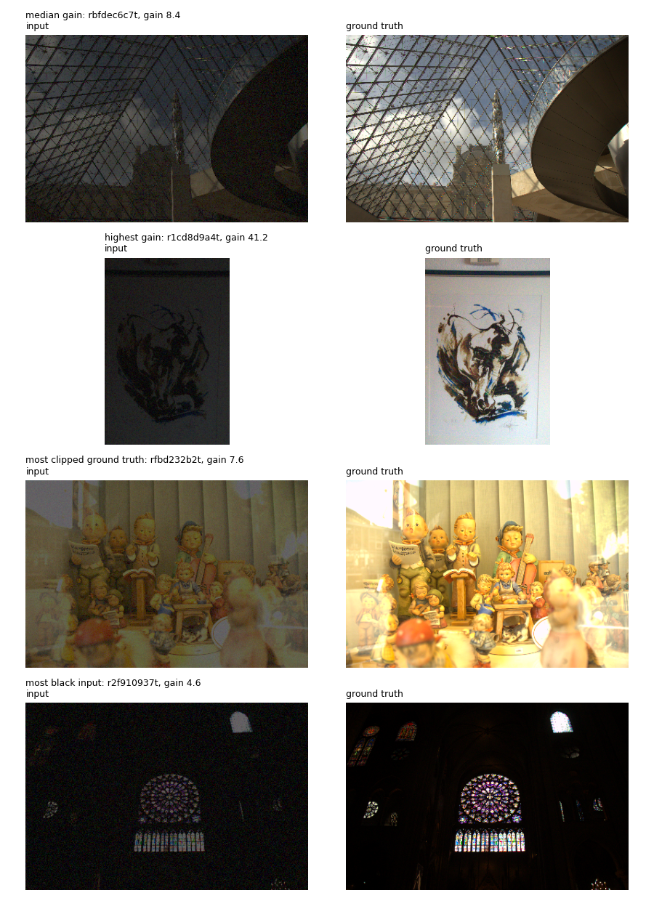
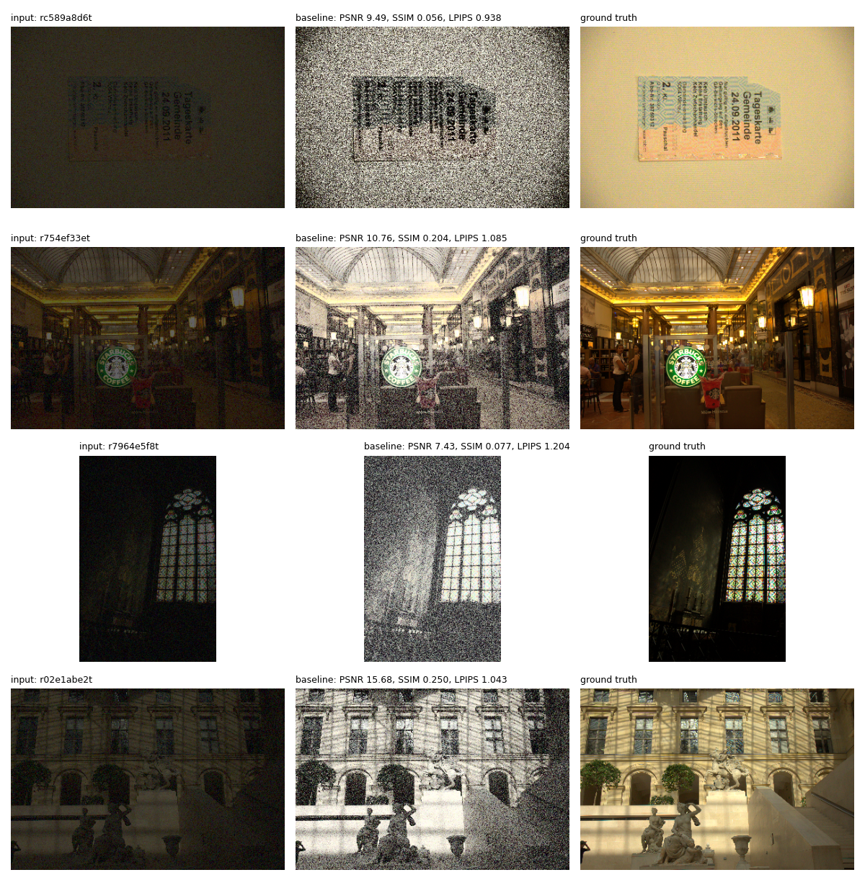
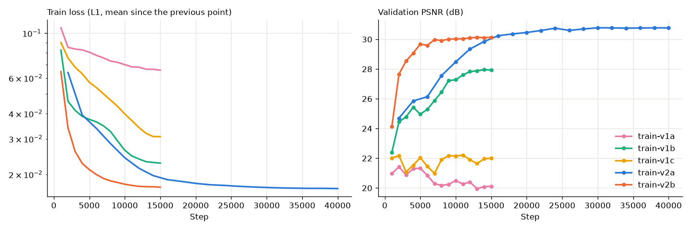
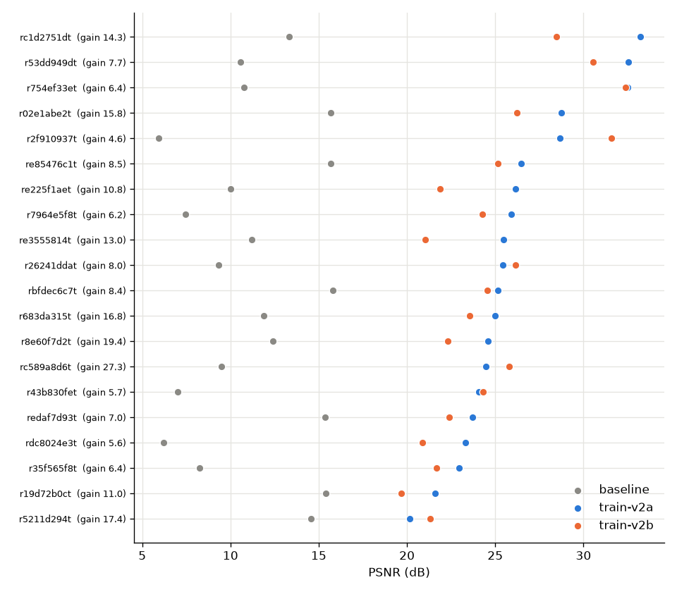
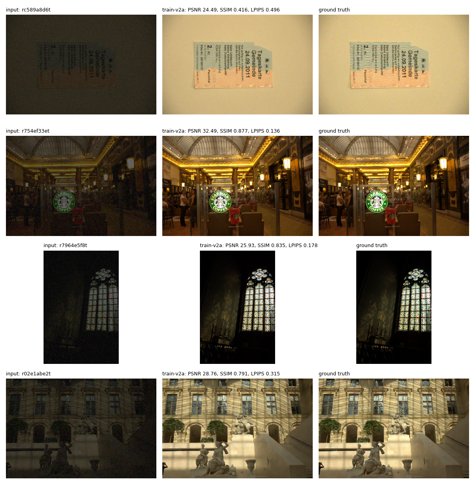

# Projekt 2: Poprawa zdjęć zrobionych przy słabym oświetleniu (SIGK)

**Autorzy:** Natalia Choszczyk, Mikołaj Rowicki

Celem projektu było zaproponowanie, wytrenowanie i ocena sieci neuronowej, która odtwarza zdjęcie zrobione przy bardzo słabym oświetleniu, czyli ciemne i zaszumione. Pary uczące tworzymy sami ze zdjęć RAW, symulując fizykę powstawania obrazu na matrycy aparatu. Sieć porównujemy z metodą bazową, czyli wyrównaniem histogramu, na 20 zdjęciach testowych przy użyciu metryk PSNR, SSIM i LPIPS. Osobno analizujemy przypadki szczególne: kolory i prześwietlenia.

## 1. Dane

Korzystamy ze zbioru RAISE: zdjęcia wnętrz (*Indoor*) zrobione aparatem Nikon D7000, pierwsze 100 pozycji z pliku `RAISE_258.csv`. Pliki RAW (NEF) dekodujemy biblioteką `rawpy` w połowie rozdzielczości (`half_size=True`), co daje obrazy 2474×1640 (59 poziomych i 41 pionowych).

### 1.1. Symulacja słabego oświetlenia

Obraz wejściowy powstaje z danych RAW w pięciu krokach, zgodnie ze skryptem z instrukcji (`data.py`):

1. **Obraz liniowy.** `postprocess` z balansem bieli aparatu, bez krzywej gamma (`gamma=(1, 1)`), bez automatycznej jasności, 16 bitów, przeskalowany do [0, 1]. Wartość piksela jest tu proporcjonalna do ilości światła.
2. **Obniżenie ekspozycji o 3 EV.** Każdy stopień EV to dwa razy mniej światła, więc obraz mnożymy przez 2⁻³ = 1/8.
3. **Szum matrycy.** Szum fotonowy Poissona (α = 0.001, piksel o wartości *x* odpowiada *x*/α zliczonym fotonom) i szum elektroniczny odczytu Gaussa (σ = 0.005), a potem przycięcie do [0, 1]. Szum Poissona rośnie z jasnością, ale względnie jest największy w ciemnych partiach. Na przykład szarość średnia (0.18) po obniżeniu ekspozycji to około 22 fotonów, czyli stosunek sygnału do szumu tylko około 4.7.
4. **Krzywa gamma** *x*^(1/2.2), która przenosi obraz do przestrzeni wyświetlania.
5. **Konwersja do 8 bitów.**

Ważna konsekwencja: najjaśniejszy możliwy piksel wejścia to (1/8)^(1/2.2) ≈ 0.39, czyli około 99 w skali 0–255. Cała informacja o scenie mieści się więc w około 100 poziomach jasności, a typowo 12% pikseli wejścia ma wartość 0.

### 1.2. Obraz wzorcowy i automatyczna jasność

Obraz wzorcowy (ground truth) powstaje z tego samego pliku RAW przez `postprocess` z ustawieniami domyślnymi. To oznacza, że w odróżnieniu od wejścia ma on **włączoną automatyczną jasność** i standardową krzywą tonalną BT.709. Zależność między wejściem a wzorcem nie jest więc stałym mnożnikiem 8. Każde zdjęcie jest rozjaśniane inaczej, zależnie od sceny.

Zmierzyliśmy to jako stosunek średniej jasności w przestrzeni liniowej wzorca do wejścia (*gain*, job `eda-v2`). Bez automatycznej jasności wynosiłby on 8. W rzeczywistości mediana to 7.6 (trening), 10.7 (walidacja) i 8.5 (test), a cały zakres to 4.6–41. Wartości poniżej 8 mają głównie ciemne sceny z dużą liczbą czarnych pikseli na wejściu. Tam przycięcie ujemnego szumu do zera podnosi średnią wejścia, a krzywa BT.709 wzorca różni się od czystej potęgi 2.2.

Dla sieci oznacza to, że oprócz odszumienia **musi ona oszacować, jak bardzo rozjaśnić całą scenę**. Tej informacji nie widać w małym fragmencie obrazu. Ta obserwacja zdecydowała o architekturze (punkt 3).

### 1.3. Podział danych

| Zbiór | Zdjęcia (indeksy w CSV) | Liczba | Mediana *gain* |
|---|---|---:|---:|
| treningowy | 0–41 i 53–79 | 69 | 7.6 |
| walidacyjny | 42–52 | 11 | 10.7 |
| testowy | 80–99 (zgodnie z instrukcją) | 20 | 8.5 |

Zbiór walidacyjny to jedna cała sesja zdjęciowa. Podobne ujęcia z jednej sesji nie trafiają więc jednocześnie do treningu i walidacji. Pierwszy wybrany fragment miał medianę *gain* 21.4, czyli zupełnie inną niż test, dlatego go zmieniliśmy. Walidacja służy wyłącznie do wyboru najlepszego punktu treningu.

## 2. Ocena i metoda bazowa

Wszystkie metryki liczymy na pełnych zdjęciach testowych (wartości w [0, 1]) i uśredniamy po 20 zdjęciach.

| Metryka | Znaczenie | Lepiej |
|---|---|---|
| **PSNR** [dB] | błąd na poziomie pikseli w skali logarytmicznej | wyżej |
| **SSIM** | zgodność struktury obrazu: krawędzi, kontrastu, jasności | wyżej |
| **LPIPS** (AlexNet) | podobieństwo percepcyjne, oceniane przez sieć neuronową | niżej |

**Metoda bazowa** to wyrównanie histogramu (`cv2.equalizeHist`). Wyrównujemy tylko kanał jasności Y w przestrzeni YCrCb, bo osobne wyrównanie kanałów R, G i B zmienia kolory. Wynik bazowy to PSNR 11.31 dB, SSIM 0.152 i LPIPS 1.077 (job `baseline-v1`). Wyrównanie histogramu rozjaśnia obraz, ale równocześnie mocno wzmacnia szum i nie wie, jaka powinna być docelowa jasność sceny.

## 3. Sieci

### 3.1. Architektury

Wszystkie sieci uczą się **poprawki dodawanej do wejścia**: wynik = wejście + korekta. Ostatnia warstwa jest inicjalizowana zerami, więc na początku treningu sieć zwraca po prostu wejście. Sprawdziliśmy dwie architektury:

- **U-Net** (szerokość c = 32, trzy poziomy zmniejszania, 1.9 mln parametrów), tę samą co w projekcie 1.
- **NAFNet** (c = 32, bloki enkodera 1-1-2-4, 4 bloki środkowe, 11.6 mln parametrów). To nowoczesna sieć do przywracania jakości obrazów. Zamiast zwykłych aktywacji używa bramek (*SimpleGate*), ma uproszczoną uwagę kanałową i normalizację warstw.

### 3.2. Gałąź globalna

Sieć uczymy na fragmentach 256×256, czyli około 1.6% powierzchni zdjęcia. Z takiego fragmentu nie da się ocenić, jak jasna jest cała scena, a więc ile wynosi *gain* z punktu 1.2. Dlatego dodaliśmy **gałąź globalną**:

1. Miniatura całego obrazu wejściowego (128×128) przechodzi przez cztery konwolucje z krokiem 2 i uśrednianie. Wynikiem jest wektor 64 liczb opisujący jasność i kolory sceny.
2. Ten wektor steruje cechami sieci przez warstwy **FiLM**: dla każdego kanału wylicza skalę i przesunięcie. FiLM działa w części środkowej sieci i na każdym poziomie dekodera.
3. Warstwy FiLM też są inicjalizowane zerami, więc na początku sieć z gałęzią globalną działa tak samo jak bez niej.

Gałąź dodaje około 0.2 mln parametrów. Przy predykcji wszystkie kafelki jednego zdjęcia dostają tę samą miniaturę, więc mają tę samą informację o scenie.

### 3.3. Trening i predykcja

- Funkcja straty L1, optymalizator Adam (lr = 2·10⁻⁴) z kosinusowym spadkiem do 10⁻⁶, przycinanie gradientu do 1, obliczenia w mieszanej precyzji.
- Paczki 16 losowych fragmentów 256×256 z losowymi obrotami i odbiciami.
- Co 1000 lub 2000 kroków liczymy PSNR na pełnych zdjęciach walidacyjnych i zachowujemy najlepszy model.
- Pełne zdjęcia przetwarzamy kafelkami 512×512 z zakładką 64 pikseli i łagodnym łączeniem, bo całe zdjęcie nie mieści się w pamięci GPU.
- Obliczenia na Kaggle (Tesla T4). Dwa eksperymenty jednego joba liczą się równocześnie, po jednym na każdym GPU.

## 4. Eksperymenty i wyniki

Każdy wariant zmienia jedną rzecz względem poprzedniego, tak żeby było widać efekt tej zmiany.

| Eksperyment | Model | Kroki | Parametry | Czas treningu | PSNR | SSIM | LPIPS |
|---|---|---:|---:|---:|---:|---:|---:|
| `baseline-v1` | wyrównanie histogramu | – | – | – | 11.31 | 0.152 | 1.077 |
| `train-v1a` | U-Net | 15 000 | 1.9 mln | 0.6 h | 19.78 | 0.398 | 0.520 |
| `train-v1b` | U-Net + gałąź globalna | 15 000 | 2.1 mln | 0.7 h | 24.07 | 0.587 | 0.346 |
| `train-v1c` | NAFNet | 15 000 | 11.6 mln | 2.6 h | 20.95 | 0.631 | 0.384 |
| **`train-v2a`** | **U-Net + gałąź globalna** | **40 000** | **2.1 mln** | **1.6 h** | **26.00** | 0.716 | **0.271** |
| `train-v2b` | NAFNet + gałąź globalna | 15 000 | 11.8 mln | 3.0 h | 24.71 | **0.719** | 0.286 |

Najlepszy model to `train-v2a`. Tabela wymagana w instrukcji:

| Metoda | PSNR | SSIM | LPIPS |
|---|---:|---:|---:|
| baseline (wyrównanie histogramu) | 11.31 | 0.152 | 1.077 |
| **network** (`train-v2a`) | **26.00** | **0.716** | **0.271** |

Wnioski z eksperymentów:

- **Gałąź globalna daje największy zysk:** +4.3 dB dla U-Neta (`v1a` → `v1b`) i +3.8 dB dla NAFNetu (`v1c` → `v2b`), a LPIPS spada z 0.52 do 0.35. Bez niej PSNR na walidacji zatrzymuje się na 21–22 dB już po kilku tysiącach kroków, a dla U-Neta potem nawet spada. Sieć widząca tylko fragment obrazu nie ma skąd wiedzieć, jak bardzo rozjaśnić scenę.
- **Dłuższy trening pomógł U-Netowi o kolejne 1.9 dB** (`v1b` → `v2a`), ale PSNR na walidacji przestaje rosnąć po około 24 000 kroków (30.8 dB). Dalsze wydłużanie treningu nic by już nie dało.
- **NAFNet uczy się szybciej na krok i ma najlepsze SSIM**, ale ma 5.6 razy więcej parametrów, a każdy krok trwa około 5 razy dłużej. W tym samym czasie U-Net osiąga lepsze PSNR i LPIPS.
- **Wynik testowy jest około 5 dB niższy niż walidacyjny** (26.0 wobec 30.8 dB dla `v2a`). Walidacja to jedna sesja zdjęciowa z 11 podobnymi ujęciami. Wystarcza do wyboru punktu treningu, ale nie przewiduje dobrze wyniku na innych scenach.

Sieć jest lepsza od metody bazowej na **wszystkich 20** zdjęciach testowych, o 5.6–22.8 dB. Wynik metody bazowej silnie zależy od *gain* (korelacja Spearmana 0.57). Wynik sieci prawie wcale (−0.08 dla `v2a`), co pokazuje, że gałąź globalna poprawnie ocenia jasność sceny.

## 5. Kolory i prześwietlenia

Średnie metryki nie pokazują, gdzie sieć się myli. Dlatego dla metody bazowej, `train-v2a` i `train-v2b` przeanalizowaliśmy osobno kolory i prześwietlenia, czyli przypadki szczególne wskazane w instrukcji (job `analysis-v1`, kod w `analysis.py`).

### 5.1. Sposób analizy

Piksele każdego zdjęcia testowego dzielimy według obrazu wzorcowego na cztery regiony:

| Region | Warunek (jasność Y w [0, 1]) |
|---|---|
| cienie | Y < 0.1 |
| półtony | pozostałe piksele |
| jasne partie | Y ≥ 0.7, bez prześwietleń |
| prześwietlenia | co najmniej jeden kanał ≥ 250 |

W każdym regionie liczymy średni błąd bezwzględny oraz średni błąd jasności ze znakiem. Wartość dodatnia oznacza, że wynik jest za jasny, ujemna, że za ciemny.

Kolory i ekspozycję oceniamy na całym zdjęciu:

- **Ekspozycja:** stosunek średniej jasności wyniku do wzorca w przestrzeni liniowej. Idealnie wynosi 1.
- **Zafarb:** kąt między średnim kolorem wyniku i wzorca (w przestrzeni liniowej). To typowa miara błędu balansu bieli.
- **Różnica kolorów ΔE:** średnia odległość w przestrzeni CIELAB.
- **Nasycenie:** stosunek średniego nasycenia (chroma w CIELAB) wyniku do wzorca. Wartość poniżej 1 oznacza wyblakłe kolory.
- **Odtworzenie prześwietleń:** jaka część prześwietlonych pikseli wzorca jest prześwietlona także w wyniku, i jaka część pozostałych pikseli zostaje prześwietlona niepotrzebnie.
- **PSNR po dopasowaniu wzmocnienia:** PSNR po przemnożeniu każdego kanału wyniku przez najlepszy możliwy współczynnik. Różnica między tym PSNR a zwykłym pokazuje, jaka część błędu to tylko ogólna jasność i balans bieli, a nie szczegóły obrazu.

Na koniec pokazujemy wycinki z dwóch najbardziej prześwietlonych zdjęć oraz z dwóch zdjęć o największym błędzie koloru, razem z mapą błędu.

### 5.2. Wyniki

*W przygotowaniu: wyniki joba `analysis-v1`.*

## 6. Podsumowanie

Sieć U-Net z gałęzią globalną (`train-v2a`) poprawia zdjęcie z symulowanego słabego oświetlenia z PSNR 26.0 dB, SSIM 0.716 i LPIPS 0.271, wobec 11.3 dB, 0.152 i 1.077 dla wyrównania histogramu. Kluczowe okazało się zrozumienie danych. Obraz wzorcowy ma automatycznie dobraną jasność, więc zadanie to nie tylko odszumianie i stałe rozjaśnienie ×8, ale też ocena jasności całej sceny. Mała gałąź, która widzi miniaturę całego zdjęcia, dała więcej niż zmiana architektury na pięciokrotnie większy NAFNet.
