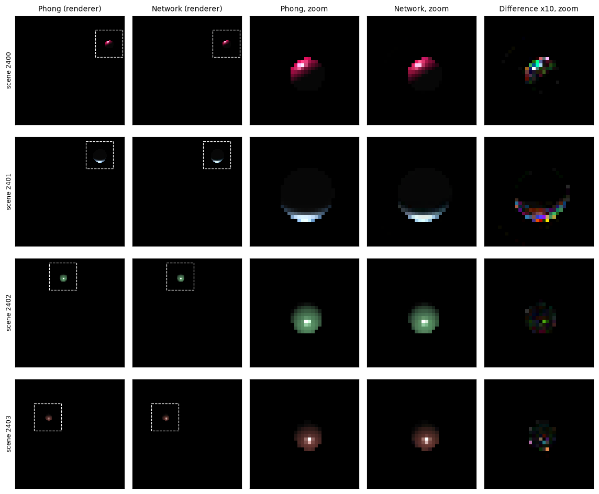
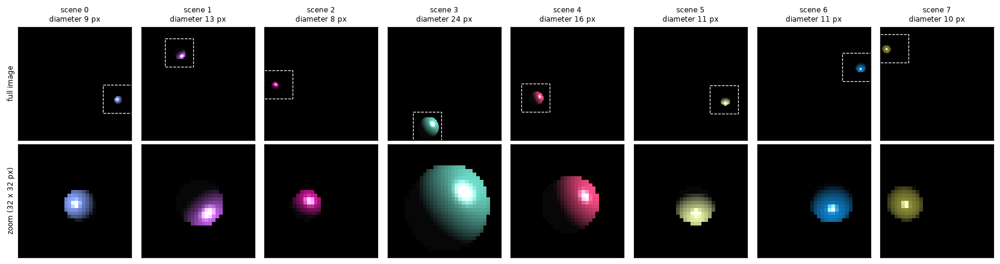
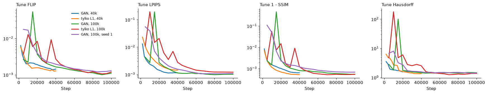
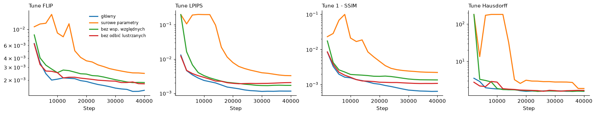
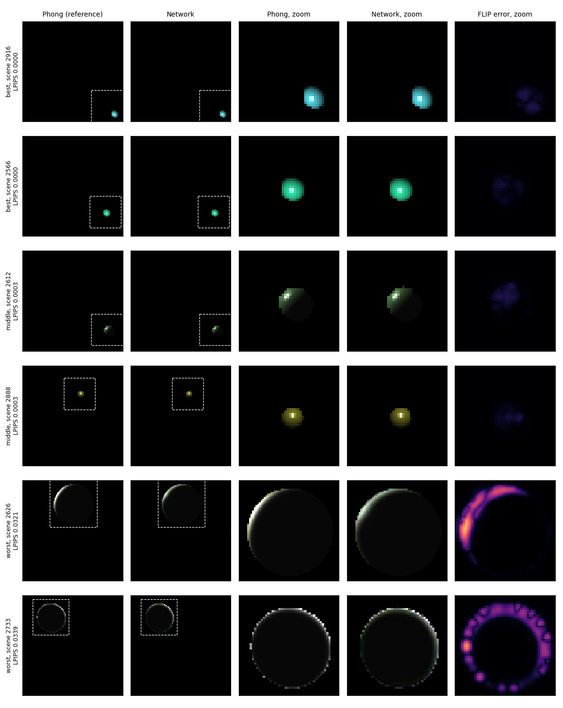
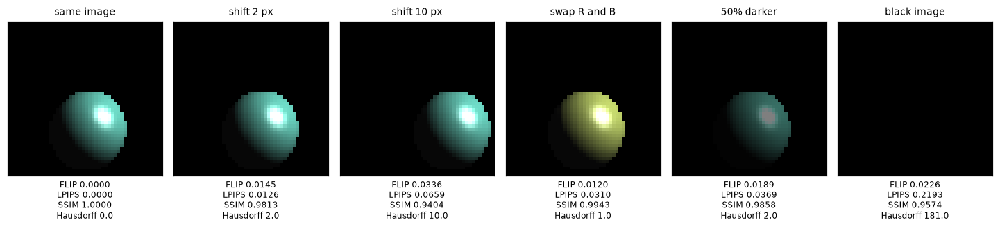

# Projekt 3: Rendering neuralny modelu Phonga (SIGK)

**Autorzy:** Natalia Choszczyk, Mikołaj Rowicki

Warunkowy GAN dostaje parametry sceny i rysuje obraz kuli oświetlonej modelem Phonga. Sieć jest spięta z dostarczonym rendererem, a jej obrazy porównujemy z referencją metrykami FLIP, LPIPS, SSIM i odległością Hausdorffa między krawędziami Canny'ego.

## Wynik

Ostateczny model `gan-v2a` uruchomiony w rendererze, średnia po 600 scenach testowych (job `render-v1`):

| Metoda | FLIP ↓ | LPIPS ↓ | SSIM ↑ | Hausdorff [px] ↓ |
|---|---:|---:|---:|---:|
| **neural_renderer** | **0.00074** | **0.00099** | **0.99950** | **1.50** |



*Pierwsze 4 sceny testowe z renderera. Kolumny: obraz Phonga, obraz sieci, powiększenie obu (obszar w przerywanym kwadracie) i różnica wzmocniona 10 razy.*

## 1. Dane

3000 obrazów 128×128 z dostarczonego renderera (job `data-v1`, seed 0). Ostatnie 600 to zbiór testowy (20%).

| Parametr | Wartość |
|---|---|
| położenie kuli i światła | każda składowa z [−20, 20] |
| kolor rozproszenia kuli | każda składowa z {0, …, 255} |
| połyskliwość | [3, 20] |
| kolor otoczenia / odbicia kuli | [76, 76, 76] / [255, 255, 255] |
| kolor światła (otoczenie, rozproszenie, odbicie) | [25, 25, 25], [255, 255, 255], [255, 255, 255] |
| kamera | stała, jak w kodzie zadania: (5, 5, 15), patrzy na (0, 0, 0), kąt widzenia 45° |

Kolory stałe ustawiliśmy w `phong.frag`. Losowanie sceny odbywa się w `PhongWindow.on_render`.

**Wskazówka 2: jaka sytuacja jest możliwa?** Kamera stoi wewnątrz sześcianu [−20, 20]³. Losowa kula może więc być za kamerą, poza kadrem albo w nią wchodzić, a światło może trafić do środka kuli (wtedy widać tylko światło otoczenia). Takie sceny odrzucamy i losujemy jeszcze raz:

- cała kula musi być w kadrze (z marginesem 1.1 promienia),
- światło musi być co najmniej 2 promienie od środka kuli.

**Wskazówka 3:** kula nie jest w środku kadru, tylko w losowym miejscu.



*Górny rząd: pełne obrazy. Dolny rząd: powiększenie kwadratu. Większość kul jest daleko od kamery: mediana średnicy to 10 px, zakres 7–77 px.*

## 2. Model

**Wejście sieci (wskazówka 1).** Zamiast surowych współrzędnych podajemy 11 cech liczonych względem kamery:

- położenie środka kuli na obrazie (x, y),
- logarytm promienia kuli na obrazie,
- kierunek od kuli do światła w układzie kamery (3 liczby),
- odległość kuli od światła,
- kolor rozproszenia (3 liczby),
- połyskliwość.

**Generator** (3.4 mln parametrów) zaczyna od mapy 4×4 i pięć razy podwaja rozmiar aż do 128×128. Każdy blok dostaje ponownie warunek jako dodatkowe kanały: 11 cech, współrzędne piksela i **współrzędne względne** (piksel − środek kuli) / promień. Dzięki temu sieć wie, gdzie jest kula, bez uczenia się rzutowania perspektywicznego.

**Dyskryminator** (1.3 mln parametrów) to warunkowy PatchGAN z normalizacją spektralną. Ocenia fragmenty 16×16.

**Trening:**

- strata: L1 × 100 + GAN (least squares) × 5; strata GAN tylko na fragmentach, które dotykają kuli, bo tło jest identyczne w obrazie prawdziwym i wygenerowanym,
- Adam (lr 2·10⁻⁴), kosinusowy spadek lr, mieszana precyzja, średnia krocząca wag generatora (EMA),
- augmentacja odbiciami lustrzanymi względem osi kamery (×4 scen),
- 2200 scen treningowych, 200 do wyboru najlepszego punktu treningu (LPIPS), 600 testowych,
- Kaggle, Tesla T4: 100 000 kroków w 168 min. Sieć generuje jeden obraz w 3.6 ms na GPU i w 54 ms na CPU.

## 3. Eksperymenty

Każdy wariant zmienia jedną rzecz względem `gan-v1a`. Metryki na 600 obrazach testowych, liczone na wyjściu sieci przed zapisem do 8 bitów.

| Wariant | Zmiana | FLIP | LPIPS | SSIM | Hausdorff |
|---|---|---:|---:|---:|---:|
| `gan-v1a` | główny, 40 000 kroków | 0.00156 | 0.00117 | 0.99927 | 1.60 |
| `gan-v1b` | tylko L1 | 0.00131 | 0.00197 | 0.99940 | 2.09 |
| `gan-v1c` | surowe parametry, bez współrzędnych względnych | 0.00255 | 0.00393 | 0.99772 | 2.38 |
| `gan-v1d` | bez współrzędnych względnych | 0.00186 | 0.00143 | 0.99905 | 1.65 |
| `gan-v1e` | waga GAN 1 | 0.00136 | 0.00134 | 0.99934 | 1.58 |
| `gan-v1f` | seed 1 | 0.00131 | 0.00103 | 0.99936 | 1.50 |
| **`gan-v2a`** | **100 000 kroków** | **0.00115** | **0.00099** | **0.99949** | **1.50** |
| `gan-v2b` | bez odbić lustrzanych | 0.00204 | 0.00234 | 0.99881 | 2.32 |
| `gan-v3a` | tylko L1, 100 000 kroków | 0.00118 | 0.00156 | 0.99944 | 1.80 |
| `gan-v3b` | 100 000 kroków, seed 1 | 0.00142 | 0.00109 | 0.99930 | 1.59 |





*Metryki na 200 scenach do wyboru modelu, skala logarytmiczna (SSIM jako 1 − SSIM).*

Wnioski:

- **Zapis parametrów ma największe znaczenie.** Z surowymi współrzędnymi sieć dopiero po ok. 15 000 krokach znajduje kulę, a LPIPS jest 3–4 razy gorszy.
- **Odbicia lustrzane** chronią przed przeuczeniem: bez nich LPIPS rośnie po 20 000 kroków.
- **GAN a samo L1:** przy 100 000 krokach GAN jest lepszy we wszystkich metrykach. Przy 40 000 krokach L1 ma lepsze FLIP i SSIM, a GAN lepsze LPIPS i Hausdorffa.
- Dłuższy trening pomaga do ok. 80 000 kroków.



*Dwie najlepsze, dwie środkowe i dwie najgorsze sceny według LPIPS. Ostatnia kolumna to mapa błędu FLIP (czarny = brak różnicy, żółty = duża różnica). Najgorsze są sceny ze światłem za kulą, gdzie widać tylko cienki jasny brzeg. Sieć rysuje go trochę zbyt gładko.*

## 4. Sieć w rendererze

`renderer/src/neural_window.py` losuje scenę, rysuje ją modelem Phonga i obok pokazuje obraz z generatora:

```bash
python 03-rendering/renderer/src/main.py --generator <ścieżka do generator.pt> --scene_seconds 2
```

Plik `generator.pt` jest w wynikach joba Kaggle `sigk-p3-train-v2ab` (`gan-v2a/generator.pt`). Z `--output_path` okno zapisuje pary obrazów.

Sprawdzenie w jobie `render-v1` na tych samych 3000 scenach:

- wszystkie 3000 obrazów Phonga są identyczne ze zbiorem danych,
- obraz sieci różni się od predykcji z treningu najwyżej o 1/255,
- FLIP w rendererze (0.00074) jest niższy niż w treningu (0.00115), bo renderer zapisuje obraz 8-bitowy (punkt 5.3).

## 5. Czy wszystkie metryki dobrze oddają jakość?

**Nie.** Każda metryka ma inną słabość.

### 5.1. Proste zmiany obrazu



*Jedna scena z prostymi zmianami. Rysunek pokazuje powiększenie, a metryki są liczone na pełnym obrazie.*

Średnia po 600 obrazach testowych:

| Zmiana | FLIP | LPIPS | SSIM | Hausdorff |
|---|---:|---:|---:|---:|
| ten sam obraz | 0.0000 | 0.0000 | 1.0000 | 0.0 |
| przesunięcie o 2 px | 0.0052 | 0.0164 | 0.9897 | 2.6 |
| przesunięcie o 10 px | 0.0115 | 0.0811 | 0.9747 | 14.3 |
| zamiana R i B | 0.0027 | 0.0212 | 0.9974 | 1.0 |
| 50% ciemniej | 0.0055 | 0.0299 | 0.9949 | 1.4 |
| czarny obraz | 0.0067 | 0.1959 | 0.9842 | 181.0 |

- **Czarny obraz dostaje lepszy FLIP niż przesunięcie o 10 px i SSIM 0.98.** FLIP i SSIM uśredniają błąd po wszystkich pikselach, a ok. 99% pikseli to tło.
- **Tylko LPIPS** ocenia czarny obraz jako najgorszy.
- **Hausdorff** widzi tylko położenie krawędzi, więc prawie nie zauważa zmiany koloru. Dla obrazu bez krawędzi jest nieokreślony; wtedy przyjmujemy przekątną obrazu (181 px).

### 5.2. Wartość zależy od ilości tła

| Ten sam obraz sieci | FLIP | LPIPS | SSIM | Hausdorff |
|---|---:|---:|---:|---:|
| cały obraz 128×128 | 0.00074 | 0.00099 | 0.99950 | 1.50 |
| wycinek 64×64 wokół kuli | 0.00295 | 0.00191 | 0.99782 | 1.50 |

| Średnica kuli [px] | Obrazy | FLIP | LPIPS | SSIM | Hausdorff |
|---|---:|---:|---:|---:|---:|
| 6–8 | 57 | 0.00038 | 0.00025 | 0.99988 | 1.07 |
| 8–10 | 249 | 0.00045 | 0.00048 | 0.99983 | 1.15 |
| 10–13 | 171 | 0.00060 | 0.00078 | 0.99967 | 1.45 |
| 13–20 | 100 | 0.00103 | 0.00154 | 0.99921 | 2.03 |
| ≥ 20 | 23 | 0.00451 | 0.00751 | 0.99500 | 4.40 |

Błąd sieci jest ten sam, a FLIP na wycinku jest 4 razy większy. Wszystkie metryki rosną z wielkością kuli. Średnia zależy więc od tego, ile w zbiorze testowym jest dużych kul, a nie tylko od jakości sieci.

### 5.3. FLIP widzi niewidoczny błąd

Ten sam model: FLIP 0.00115 na wyjściu sieci i 0.00074 po zapisie do PNG, lepiej dla wszystkich 600 obrazów. Zaokrąglenie do 8 bitów zeruje bardzo małe wartości tła. Oko ich nie widzi, ale FLIP sumuje je po całym tle. Pozostałe metryki prawie się nie zmieniają.

### 5.4. Szum treningu

| Model | FLIP | LPIPS | SSIM | Hausdorff |
|---|---:|---:|---:|---:|
| GAN, 100k, seed 0 | 0.00115 | 0.00099 | 0.99949 | 1.50 |
| GAN, 100k, seed 1 | 0.00142 | 0.00109 | 0.99930 | 1.59 |
| tylko L1, 100k | 0.00118 | 0.00156 | 0.99944 | 1.80 |

W FLIP i SSIM różnica między dwoma seedami GAN jest tak duża jak różnica między GAN a L1, więc te metryki nie rozstrzygają, który model jest lepszy. W LPIPS i Hausdorffie GAN wygrywa dla obu seedów.

Korelacja rang (Spearman) między metrykami na 600 obrazach: LPIPS–SSIM −0.82, FLIP–LPIPS 0.54, Hausdorff z pozostałymi tylko 0.3–0.4.

### 5.5. Odpowiedź

- **FLIP i SSIM** na tych obrazach mierzą głównie tło: czarny obraz dostaje dobre wyniki, a wartość zmienia się z wielkością kadru i z niewidocznym zaokrągleniem.
- **Hausdorff** widzi tylko kształt (krawędzie), nie kolor ani jasność, i jest nieokreślony dla obrazu bez krawędzi.
- **LPIPS** działa tu najlepiej: wykrywa brak obiektu i najlepiej zgadza się z innymi metrykami.

Do rzetelnej oceny potrzeba kilku metryk, najlepiej liczonych też na wycinku wokół obiektu, i obejrzenia najgorszych obrazów.

## Pliki

- `data.py`: losowanie scen, cechy wejściowe, odbicia lustrzane, wczytywanie danych.
- `model.py`: generator i dyskryminator.
- `training.py`: trening, ocena i rysunki.
- `metrics.py`: FLIP, LPIPS, SSIM, Hausdorff i analiza metryk.
- `renderer/`: renderer z zadania z losowaniem scen (`phong_window.py`) i oknem z siecią (`neural_window.py`).
- `experiments.ipynb`: wszystkie wyniki i rysunki.
- `jobs/`: joby Kaggle, `results/`: małe wyniki jobów, `WORKLOG.md`: historia pracy.
